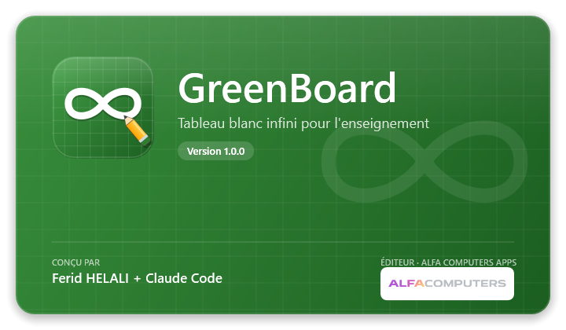

<p align="center">
  
</p>

# GreenBoard

**Tableau blanc infini pour l'enseignement**, natif Windows (WPF / .NET 9), hors ligne, pensé pour les
enseignants qui écrivent au stylet. Conçu par **Ferid HELALI + Claude Code** — édité par **Alfa Computers Apps**.

*An infinite whiteboard for teachers on Windows: pen & pressure, shapes, pages, PDF export, e-mail sharing,
and AI-drawn course illustrations through MCP (Claude, OpenCode…).*

## Télécharger

➡️ **[Dernière version (installateur Windows)](https://github.com/feridHelali/GreenBoard/releases/latest)** —
`GreenBoard-Setup-x.y.z.exe`

- Windows 10 (1809) ou 11, 64 bits. **Rien d'autre à installer** : .NET est inclus.
- Installation pour l'utilisateur courant, **sans droits administrateur**.
- L'installateur n'est pas signé : Windows affiche « Windows a protégé votre ordinateur » →
  **Informations complémentaires → Exécuter quand même**.

## Fonctionnalités

| | |
|---|---|
| ✍️ **Écriture naturelle** | Stylet sensible à la pression (XP-Pen, Wacom…), tracé lissé, 6 couleurs dont le blanc craie |
| 🔷 **Formes** | Rectangle, ellipse, triangle, ligne, flèche (Maj : carré, cercle, 45°) — effaçables comme l'encre |
| 🖐️ **Sélection** | Déplacer, redimensionner, faire pivoter, recolorer, supprimer |
| ♾️ **Canevas infini** | Zoom 10 %–1000 %, Espace + glisser pour se déplacer, 6 fonds : blanc, tableau vert, quadrillage, millimétré, Seyès, pointillés |
| 📑 **Pages en onglets** | Titres modifiables, chacune avec son fond, sa vue et son historique |
| 🖼️ **Images** | Import PNG/JPEG, glisser-déposer, coller, annotation |
| ↩️ **Annuler / Rétablir** | Sans limite, un geste = une étape |
| 💾 **Fichiers `.gboard`** | Toutes les pages dans un fichier, sauvegarde automatique au choix |
| 📤 **Export** | PDF vectoriel multipage, PNG, JPEG, SVG |
| ✉️ **Partage** | PDF joint à un e-mail de votre messagerie |
| ✨ **Illustrations par l'IA** | Serveur MCP : Claude, OpenCode (gratuit) ou tout assistant MCP dessine vos schémas de cours sur le tableau |
| ⚙️ **Réglages et aide** | Roue dentée et « ? » en bas à gauche, F1 : fonctionnalités, raccourcis, assistant IA, à propos |

## Assistant IA (MCP)

Cochez « Serveur MCP pour assistants IA » à l'installation (type **Complète**), puis ouvrez
**Aide (F1) › Assistant IA** dans GreenBoard : les blocs de configuration à copier (Claude Desktop, Claude Code,
OpenCode, autres clients MCP) y sont générés avec le bon chemin, avec 10 demandes types par matière.

## Développement

```powershell
dotnet build InfiniteCanvas.sln
dotnet test  InfiniteCanvas.sln
dotnet run   --project src\InfiniteCanvas.App\InfiniteCanvas.App.csproj
pwsh -File installer\build-installer.ps1      # installateur : dist\GreenBoard-Setup-<version>.exe
```

Architecture, conventions et pièges : voir [AGENTS.md](AGENTS.md). Feuilles de route :
[Sprint 1](designDocs/01_Sprint1/SPRINT-01.md) (version 1.0.0) ·
[Sprint 2](designDocs/02_Sprint2/SPRINT-02.md) (compte optionnel et espace en ligne, hébergé sur Render).

---

© 2026 Ferid HELALI — Alfa Computers Apps
